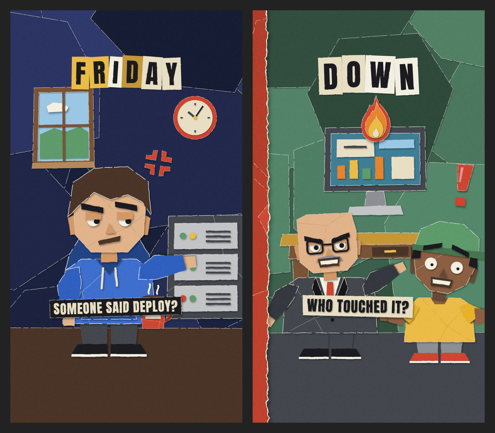

# collage-motion

[English](README.md) · [Português (Brasil)](README.pt-BR.md) · **Español**

**Vídeos de papel recortado, hechos por tu agente de IA.** Tú dices de qué trata el vídeo; el agente escribe unos pocos archivos sencillos; la herramienta recorta el papel, proyecta las sombras, añade el sonido y lo graba todo en tu propio ordenador.


**[Míralo con sonido](docs/demo.es.mp4)**: narración, efectos de papel y cada corte, cara y zoom cayendo en su palabra. La voz es de ElevenLabs (`eleven_v4`); todo lo demás lo hizo la herramienta. Sus archivos están en [`examples/meeting`](examples/meeting), en español, inglés y portugués.



## Para qué sirve

Vídeos verticales cortos (Reels, TikTok, Shorts), explicativos, memes e imágenes fijas con un único estilo, fácil de reconocer: todo lo que aparece en pantalla es papel, recortado y pegado. Fondos en mosaico, personajes montados con piezas, letras recortadas una a una, la hoja que se rasga de una escena a la siguiente, movimiento a 12 dibujos por segundo.

No necesitas saber dibujar, animar ni editar vídeo. Tampoco necesitas un generador de imágenes: aquí nada lo genera un modelo. El agente escribe formas (SVG) y una línea de tiempo (JSON), y los mismos archivos dan siempre la misma imagen, así que puedes corregir un detalle sin perder el resto.

- **Gratis y local.** Sin cuenta, sin clave de API, sin servicios de pago. Renderiza con un navegador y ffmpeg en tu ordenador.
- **Rápido.** Diez segundos de vídeo a 1080×1920 tardan unos pocos segundos en grabarse.
- **Tuyo.** Lo que renderizas es tuyo para publicarlo y venderlo. Consulta [Licencia](#licencia).

## Funciona con cualquier agente de IA

collage-motion es una *skill de agente*: una carpeta con instrucciones (`SKILL.md`), guías de referencia y una herramienta de línea de comandos. Nada en ella depende de un modelo o de un producto concreto.

Funciona con **Claude Code, Codex, Cursor, OpenCode, Gemini CLI, Windsurf, GitHub Copilot, Aider** y cualquier otro asistente capaz de leer un archivo y ejecutar un comando en la terminal. ¿Sin agente? El comando también funciona a mano: consulta [Usarla sin agente](#usarla-sin-agente).

## Qué necesitas

| | macOS | Windows | Linux (Debian, Ubuntu) |
|---|---|---|---|
| **Node.js 18 o superior** | `brew install node` | `winget install OpenJS.NodeJS.LTS` | `sudo apt install nodejs npm` |
| **ffmpeg** (para escribir los vídeos) | `brew install ffmpeg` | `winget install Gyan.FFmpeg` | `sudo apt install ffmpeg` |
| **Un navegador basado en Chromium** | Chrome o Edge, si ya tienes alguno. Si no, consulta el paso 3. | igual | igual |

Está probada en macOS y Linux. En Windows debería funcionar, pero todavía no se ha probado.

## Instalación

### 1. Consigue la skill

Elige la línea que corresponda a lo que usas.

**Claude Code**

```sh
/plugin marketplace add eydrenn/collage-motion
/plugin install collage-motion@collage-motion
```

**Cursor, Codex, OpenCode, Gemini CLI y otros agentes con carpeta de skills**

```sh
npx skills add eydrenn/collage-motion
```

El instalador pregunta para qué agentes instalarla y coloca la carpeta en el lugar correcto de cada uno.

**Cualquier agente, a mano**

```sh
git clone https://github.com/eydrenn/collage-motion.git
```

¿No tienes git? En la página de GitHub, pulsa **Code → Download ZIP** y descomprímelo.

Después haz una de estas dos cosas:

- Copia la carpeta `skills/collage-motion` en la carpeta de skills de tu agente: `~/.claude/skills/`, `~/.codex/skills/`, `~/.cursor/skills/`, `~/.config/opencode/skills/`, `~/.gemini/skills/` o `~/.agents/skills/`.
- O déjala donde está e indícale al agente dónde encontrarla. En el chat, o en el archivo de instrucciones que lee tu agente (`AGENTS.md`, `CLAUDE.md`, una regla de Cursor), escribe:

  > Para vídeos de collage, lee `/ruta/a/collage-motion/skills/collage-motion/SKILL.md` y sigue lo que dice.

### 2. Instala su única dependencia

Una vez por máquina, en la carpeta donde quedó la skill:

```sh
npm install --prefix /ruta/a/skills/collage-motion
```

### 3. Comprueba la máquina

```sh
node /ruta/a/skills/collage-motion/scripts/collage.mjs doctor
```

Comprueba Node, el navegador y ffmpeg, y muestra cómo arreglar lo que falte. Si no tienes Chrome ni Edge, este comando descarga un navegador solo para la herramienta:

```sh
npx --prefix /ruta/a/skills/collage-motion playwright-core install chromium
```

Tu agente puede ejecutar los pasos 2 y 3 por ti: `SKILL.md` se lo indica.

### Actualizar

Vuelve a traer el repositorio (`git pull`) o repite el comando de instalación que usaste.

## Haz tu primer vídeo

Abre tu agente en una carpeta vacía y pídeselo con tus palabras:

- "Haz un vídeo de collage de 10 segundos sobre un despliegue que sale mal un viernes."
- "Enséñame primero un fotograma fijo: un programador cansado en su mesa, de noche, con el rótulo 'UN BUG MÁS'."
- "Créame un personaje: alto, pelo rizado, sudadera verde, gafas."
- "Recorta una cafetera en el estilo collage."
- "Esta es mi narración (audio/voz.mp3). Haz que el vídeo siga lo que digo."

Un buen agente trabaja en pasos baratos y te enseña cada uno antes de continuar:

1. **Un fotograma fijo**, para acordar el aspecto.
2. **Una hoja de contactos**: el vídeo entero como una cuadrícula de dibujos. [Ejemplo](docs/contact-sheet.jpg).
3. **Una animática**: un vídeo pequeño y rápido para valorar el ritmo.
4. **Una vista previa** a mitad de tamaño, con todo el movimiento y el sonido.
5. **El vídeo final**, a 1080×1920.

Todo lo que renderiza va a la carpeta `out/` de tu proyecto.

### Voz, música y sonido

Los sonidos de papel ya vienen incluidos: cada entrada, cambio de pose, letra que aterriza y rasgado reproduce uno de los doce efectos integrados. Para añadir tu propio audio, pon los archivos en el proyecto y díselo al agente, o escríbelo tú en la escena:

```js
sound: { narration: "audio/voz.mp3", music: "audio/musica.mp3" }
```

Los niveles se ajustan solos: la voz a un volumen estándar y la música bajando por debajo de ella. Con los tiempos de cada palabra (de ElevenLabs, de Whisper o del `collage words` integrado), las acciones pueden ligarse a lo que se dice: `at: "word:deploy"` en lugar de segundos. La herramienta no genera voz ni música; trae las tuyas.

### Rótulos que las aplicaciones no tapan

Las zonas seguras de TikTok, Instagram Reels y YouTube Shorts vienen integradas. Un rótulo ocupa una posición prevista (`place: "caption"`) en lugar de coordenadas, la herramienta avisa cuando un texto quedaría debajo de un botón, y `--guides` dibuja las zonas encima de cualquier render. [Mira las guías](docs/safe-zones.jpg).

## Usarla sin agente

Todo lo que hace el agente es un solo comando. Desde una carpeta vacía:

```sh
alias collage="node /ruta/a/skills/collage-motion/scripts/collage.mjs"

collage doctor                      # ¿está todo en su sitio?
collage init                        # empieza un proyecto aquí, con una escena de demostración
collage check demo                  # lista los errores sin dibujar (no necesita navegador)
collage frame stills/demo.json      # un fotograma fijo         -> out/demo-still.png
collage film demo --sheet           # una hoja de contactos     -> out/demo-sheet.jpg
collage film demo --animatic        # storyboard en movimiento  -> out/demo-animatic.mp4
collage film demo --mp4             # vista previa a mitad de tamaño -> out/demo-preview.mp4
collage film demo --mp4 --final     # 1080x1920                 -> out/demo-final.mp4
```

Abre `scenes/demo/scene.mjs` y `stills/demo.json`, cambia algo y vuelve a ejecutarlo.

Para grabar el ejemplo narrado del principio de esta página, ejecuta `collage film meeting-es --mp4` dentro de [`examples/meeting`](examples/meeting) (o `meeting-en`, `meeting-pt-BR`). La narración y los tiempos de cada palabra ya están ahí, en `audio/`.

Los demás comandos:

| Comando | Qué hace |
|---|---|
| `collage library` | Lista las 60 ilustraciones que trae la skill; `--sheet` las renderiza. |
| `collage cast` | Renderiza los personajes, con todas las caras y poses. |
| `collage backgrounds` | Renderiza todos los colores de fondo. |
| `collage art <archivo.svg>` | Convierte tu propio SVG en papel recortado. |
| `collage slice` | Exporta una ilustración o un personaje como piezas PNG transparentes, para otro editor. |
| `collage words <archivo>` | Lista los tiempos de las palabras de una narración, o los obtiene a partir del audio. |
| `collage sounds` | Muestra qué sonido reproduce cada evento; `--copy` te da los sonidos integrados para sustituirlos. |
| `collage selftest` | Renderiza los ejemplos y comprueba los resultados. |

La carpeta de un proyecto queda así:

```
art/*.svg                tus ilustraciones (un archivo con el nombre de una de la biblioteca la sustituye)
characters.json          tus personajes, sumados a los que ya vienen
stills/*.json            fotogramas fijos
scenes/<nombre>/scene.mjs  escenas
sounds/                  tus efectos de sonido, un archivo por tipo de evento
out/                     todo lo que renderiza la herramienta
.collage-cache/          piezas ya rasterizadas; se puede borrar sin problema
```

Los comandos, los campos y los nombres de las ilustraciones están en inglés; los textos del vídeo los escribes en el idioma que quieras.

## Qué incluye

- **Un motor de papel.** Cada forma se convierte en un trozo de papel con grano, un corte ligeramente irregular, un borde blanco rasgado y una sombra corta.
- **60 ilustraciones**: tecnología, muebles, escenarios, símbolos y reacciones. [Mira la hoja](docs/library.jpg).
- **Personajes a partir de una ficha.** Un personaje son unas pocas líneas de JSON: cuerpo, cabeza, pelo, ropa. Viene con 22 caras y 29 poses; los brazos se doblan por el codo y el personaje puede sentarse. [Mira el reparto](docs/cast.jpg).
- **Texto de letras recortadas**, sobre tiras de papel o una letra por recorte, como una nota de rescate.
- **Fondos** hechos de recortes superpuestos de un mismo color. [Míralos](docs/backgrounds.jpg).
- **Un motor de escenas.** Las piezas saltan, caen y entran deslizándose; las poses cambian en un solo tiempo; las letras vuelan hasta su tira; la hoja se rasga entre escenas; la cámara se acerca despacio, hace un zoom seco en la reacción y tiembla en el impacto.
- **Sonido.** Doce efectos de papel colocados en cada evento, tu narración y tu música mezcladas por debajo, niveles ajustados automáticamente.
- **Zonas seguras** medidas en las tres grandes aplicaciones de vídeo vertical, con posiciones para rótulos y avisos.

## Documentación

Las guías están escritas para agentes y para personas, en inglés, en `skills/collage-motion/references/`:

| Guía | Qué cubre |
|---|---|
| [art.md](skills/collage-motion/references/art.md) | Cómo recortar una ilustración |
| [characters.md](skills/collage-motion/references/characters.md) | El reparto, las caras y las poses |
| [scenes.md](skills/collage-motion/references/scenes.md) | Fotogramas, escenas, acciones, cámara y grabación |
| [direction.md](skills/collage-motion/references/direction.md) | Cómo planificar una pieza: ritmo, cortes, cámara |
| [sound.md](skills/collage-motion/references/sound.md) | Efectos, narración y música |
| [voice.md](skills/collage-motion/references/voice.md) | Narración, y cómo ligar la escena a las palabras |
| [safe-zones.md](skills/collage-motion/references/safe-zones.md) | Dónde van los rótulos y qué tapa cada aplicación |
| [library.md](skills/collage-motion/references/library.md) | Las ilustraciones que trae la skill |

## Preguntas

**¿Cuesta algo?** No. Se ejecuta en tu ordenador y no llama a ningún servicio de pago. Una voz o una música que hagas en otro sitio corre de tu cuenta.

**¿Necesita internet?** Solo para instalarla. El renderizado es sin conexión.

**¿Puedo usar los vídeos con fines comerciales?** Sí, sin necesidad de atribución. La herramienta es MIT, así que también puedes modificarla y construir sobre ella.

**`doctor` dice que el navegador "was not allowed to start".** Algunos agentes ejecutan los comandos dentro de un sandbox donde ningún navegador puede arrancar. Deja que el agente ejecute los comandos `collage` fuera de su sandbox. Dentro de él, `collage check` sigue funcionando: encuentra los errores sin dibujar.

**¿Puedo usar mis propios dibujos, personajes y sonidos?** Sí. Tus SVG van en `art/`, tus personajes en `characters.json`, tus grabaciones en `sounds/`. Sustituyen o se suman a lo que ya viene.

**¿Qué no hace?** No genera voces ni música. La boca no se mueve al hablar. Los personajes se ven de frente y no caminan. La cámara no sigue a una pieza en movimiento. El formato probado es el vertical de 1080×1920; el cuadrado y el horizontal también se renderizan.

## Licencia

[MIT](LICENSE). Úsala, modifícala y distribúyela, en trabajos personales o comerciales; conserva el aviso de copyright cuando redistribuyas la propia herramienta.

**Lo que haces con ella es tuyo.** Los vídeos y las imágenes que renderizas, incluidas las ilustraciones de la biblioteca, los personajes, los sonidos y las letras tal como aparecen en ellos, no necesitan atribución y no llevan ninguna condición.

## Créditos

El texto usa la fuente [Anton](https://github.com/googlefonts/AntonFont), bajo la SIL Open Font License 1.1.
