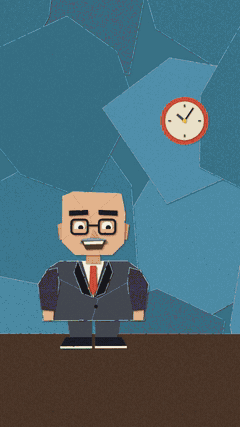
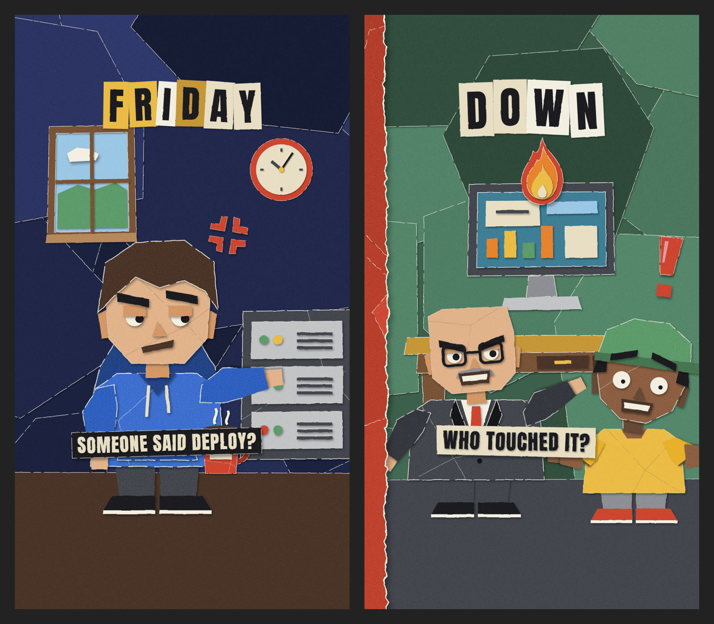

# collage-motion

A skill that lets an AI coding agent make **paper-cutout videos**: art, characters, still frames and short clips where everything looks cut from paper and glued down. You describe shapes and what happens when, in plain SVG and JSON files; the tool cuts the paper, casts the shadows and films it, on your machine.

It works with any agent that can read files and run a command: Claude Code, Codex, and others.





## What is in it

- **A paper engine.** Every shape becomes a piece of paper with grain, a slightly uneven cut, a white torn rim and a short shadow.
- **A library of 60 pieces of art**: tech, furniture and scenery, symbols and reactions. [See the sheet](docs/library.jpg).
- **Characters from a sheet.** A character is a few lines of JSON: body, head, hair, outfit. Twenty-two faces and twenty-nine poses come with it; arms bend at the elbow and a character can sit. [See the cast](docs/cast.jpg).
- **Text made of cut letters**, on paper strips or one letter per scrap, like a ransom note.
- **Backgrounds** made of overlapping scraps of one colour. [See them](docs/backgrounds.jpg).
- **Captions where the apps do not cover them.** Safe zones for TikTok, Instagram Reels and YouTube Shorts are built in: a caption takes a slot instead of coordinates, a warning says when text would end up under a button, and `--guides` draws the zones over any render.
- **Timed to the voice.** Write `at: "word:deploy"` instead of seconds: the scene reads the word timings of your narration (from ElevenLabs, Whisper, or the built-in `collage words`), and every action lands on its word.
- **Sound out of the box.** The engine knows the instant of every entrance, pose change, landing letter and tear, and plays a paper sound on each: twelve built-in effects, replaceable by your own recordings. Your narration and music go under them, and the levels are set for you: every effect at the level of its kind, the voice at a standard loudness, the music ducking under it.
- **A scene engine**: shots, layers and timed actions, at 12 drawings a second. Pieces pop, drop and slide in; poses change in one beat; letters fly to their strip; the sheet tears from one shot to the next; the camera pushes in slowly, punches in on a reaction and shakes on an impact. [See a contact sheet](docs/contact-sheet.jpg).

Rendering is fast: the pieces are rasterized once and cached, so ten seconds of 1080×1920 video take a few seconds to film.

## Requirements

- Node.js 18 or newer
- A Chromium-based browser: Chrome or Edge already installed, or the one Playwright downloads
- ffmpeg, only to write video files

`collage doctor` checks all three and tells you how to fix what is missing.

A browser cannot start inside the sandbox some coding agents run their commands in. If `doctor` says the browser "was not allowed to start", let the agent run the `collage` commands outside its sandbox.

## Install

### Claude Code

```sh
/plugin marketplace add eydrenn/collage-motion
/plugin install collage-motion@collage-motion
```

### Any agent that uses skill folders

```sh
npx skills add eydrenn/collage-motion
```

### By hand

Clone this repository and copy `skills/collage-motion` to wherever your agent keeps its skills (for example `.claude/skills/` or `.agents/skills/`). If your agent has no skills at all, tell it to read `skills/collage-motion/SKILL.md` and follow it.

Then, once per machine:

```sh
npm install --prefix path/to/skills/collage-motion
```

## Use

Ask your agent, for example:

- "Make a 10-second collage video about a deploy going wrong on a Friday."
- "Show me a still first: a tired developer at a desk at night, caption 'ONE MORE BUG'."
- "Add a character for me: tall, curly hair, green hoodie."
- "Cut out a coffee machine in the collage style."

Or run it yourself. From an empty folder:

```sh
alias collage="node path/to/skills/collage-motion/scripts/collage.mjs"

collage doctor                      # is everything in place?
collage init                        # start a project here
collage check demo                  # warnings only, no drawing (needs no browser)
collage frame stills/demo.json      # a still frame        -> out/demo-still.png
collage film demo --sheet           # a contact sheet      -> out/demo-sheet.jpg
collage film demo --animatic        # storyboard in motion -> out/demo-animatic.mp4
collage film demo --mp4             # a half-size preview  -> out/demo-preview.mp4
collage film demo --mp4 --final     # 1080x1920            -> out/demo-final.mp4
```

Your project folder ends up like this:

```
art/*.svg                your own art (a file named like a library art replaces it)
characters.json          your own cast, added to the shipped one
stills/*.json            still frames
scenes/<name>/scene.mjs  scenes
sounds/                  your sound effects, one file per kind of event
out/                     everything the tool renders
.collage-cache/          rasterized pieces; safe to delete
```

## Documentation

The references are written for agents and people alike, in `skills/collage-motion/references/`:

- [art.md](skills/collage-motion/references/art.md): how to cut out a piece of art
- [characters.md](skills/collage-motion/references/characters.md): the cast, faces and poses
- [scenes.md](skills/collage-motion/references/scenes.md): stills, scenes, actions and filming
- [direction.md](skills/collage-motion/references/direction.md): how to plan a piece, with measured rhythm
- [sound.md](skills/collage-motion/references/sound.md): effects, narration and music
- [voice.md](skills/collage-motion/references/voice.md): narration, and timing a scene to its words
- [safe-zones.md](skills/collage-motion/references/safe-zones.md): where captions go, and what each app covers
- [library.md](skills/collage-motion/references/library.md): the art that ships with the skill

## Limits

It has built-in sound effects and mixes your narration and music, but it does not generate voices or music. It costs nothing to run and calls no paid service. No talking mouths. The camera does not follow a moving piece. Characters are seen from the front only and do not walk. Vertical 1080×1920 is the tested format; square and horizontal render too.

## License

[GNU Affero General Public License v3.0](LICENSE). If you distribute a modified version, or run one as a service for other people, you have to publish its source under the same license.

The license is about the tool. **What you make with it is yours**: the videos and images you render, including the library art, the characters, the sounds and the letters as they appear in them, carry no condition from this license.

## Credits

The text is set in [Anton](https://github.com/googlefonts/AntonFont), under the SIL Open Font License 1.1.
