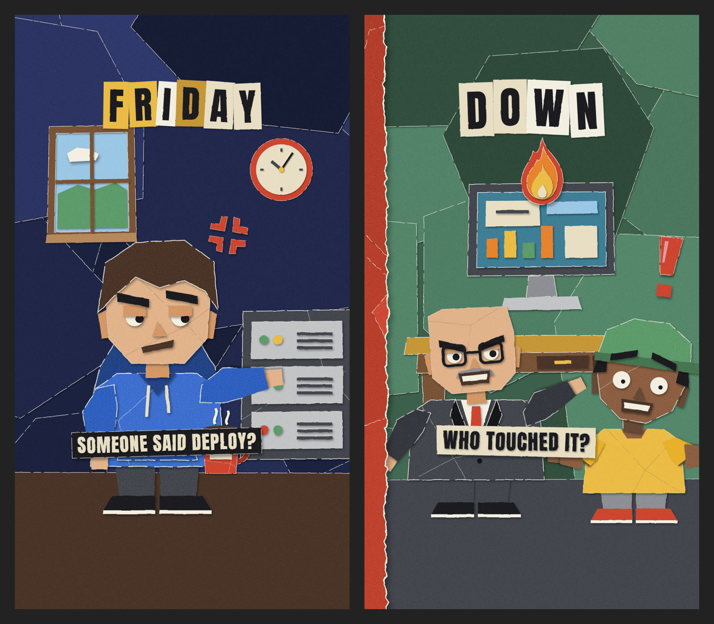

# collage-motion

[English](README.md) · **Português (Brasil)** · [Español](README.es.md)

**Vídeos em papel recortado, feitos pelo seu agente de IA.** Você diz sobre o que é o vídeo; o agente escreve alguns arquivos simples; a ferramenta recorta o papel, projeta as sombras, coloca o som e filma tudo na sua própria máquina.


**[Assista com som](docs/demo.pt-BR.mp4)**: narração, efeitos de papel e cada corte, rosto e zoom caindo na palavra certa. A voz é do ElevenLabs (`eleven_v4`); todo o resto foi feito pela ferramenta. Os arquivos estão em [`examples/meeting`](examples/meeting), em português, inglês e espanhol.



## Para que serve

Vídeos verticais curtos (Reels, TikTok, Shorts), explicativos, memes e imagens paradas com uma cara só, fácil de reconhecer: tudo na tela é papel, recortado e colado. Fundos em mosaico, personagens montados com peças, letras recortadas uma a uma, a folha rasgando de uma cena para a outra, movimento a 12 desenhos por segundo.

Você não precisa saber desenhar, animar nem editar vídeo. Também não precisa de gerador de imagem: nada aqui é gerado por um modelo. O agente escreve formas (SVG) e uma linha do tempo (JSON), e os mesmos arquivos dão sempre a mesma imagem, então dá para corrigir um detalhe sem perder o resto.

- **Gratuito e local.** Sem conta, sem chave de API, sem serviço pago. Renderiza com um navegador e o ffmpeg no seu computador.
- **Rápido.** Dez segundos de vídeo em 1080×1920 levam poucos segundos para filmar.
- **Seu.** O que você renderiza é seu para postar e vender. Veja [Licença](#licença).

## Funciona com qualquer agente de IA

A collage-motion é uma *skill de agente*: uma pasta com instruções (`SKILL.md`), guias de referência e uma ferramenta de linha de comando. Nada nela depende de um modelo ou produto específico.

Funciona com **Claude Code, Codex, Cursor, OpenCode, Gemini CLI, Windsurf, GitHub Copilot, Aider** e qualquer outro assistente que consiga ler um arquivo e rodar um comando no terminal. Sem agente nenhum? O comando também funciona à mão: veja [Usar sem agente](#usar-sem-agente).

## O que você precisa

| | macOS | Windows | Linux (Debian, Ubuntu) |
|---|---|---|---|
| **Node.js 18 ou mais novo** | `brew install node` | `winget install OpenJS.NodeJS.LTS` | `sudo apt install nodejs npm` |
| **ffmpeg** (para gravar os vídeos) | `brew install ffmpeg` | `winget install Gyan.FFmpeg` | `sudo apt install ffmpeg` |
| **Um navegador baseado em Chromium** | Chrome ou Edge, se você já tiver. Senão, veja o passo 3 abaixo. | igual | igual |

Foi testada em macOS e Linux. No Windows deve funcionar, mas ainda não foi testada.

## Instalação

### 1. Baixe a skill

Escolha a linha que combina com o que você usa.

**Claude Code**

```sh
/plugin marketplace add eydrenn/collage-motion
/plugin install collage-motion@collage-motion
```

**Cursor, Codex, OpenCode, Gemini CLI e outros agentes com pasta de skills**

```sh
npx skills add eydrenn/collage-motion
```

O instalador pergunta para quais agentes instalar e coloca a pasta no lugar certo de cada um.

**Qualquer agente, à mão**

```sh
git clone https://github.com/eydrenn/collage-motion.git
```

Não tem git? Na página do GitHub, clique em **Code → Download ZIP** e descompacte.

Depois, faça uma destas duas coisas:

- Copie a pasta `skills/collage-motion` para a pasta de skills do seu agente: `~/.claude/skills/`, `~/.codex/skills/`, `~/.cursor/skills/`, `~/.config/opencode/skills/`, `~/.gemini/skills/` ou `~/.agents/skills/`.
- Ou deixe onde está e aponte o agente para ela. No chat, ou no arquivo de instruções que o seu agente lê (`AGENTS.md`, `CLAUDE.md`, uma regra do Cursor), escreva:

  > Para vídeos de colagem, leia `/caminho/para/collage-motion/skills/collage-motion/SKILL.md` e siga o que está lá.

### 2. Instale a única dependência

Uma vez por máquina, na pasta onde a skill ficou:

```sh
npm install --prefix /caminho/para/skills/collage-motion
```

### 3. Confira a máquina

```sh
node /caminho/para/skills/collage-motion/scripts/collage.mjs doctor
```

Ele confere o Node, o navegador e o ffmpeg e mostra como resolver o que estiver faltando. Se você não tem Chrome nem Edge, este comando baixa um navegador só para a ferramenta:

```sh
npx --prefix /caminho/para/skills/collage-motion playwright-core install chromium
```

O seu agente pode rodar os passos 2 e 3 por você: o `SKILL.md` manda fazer isso.

### Atualizar

Puxe o repositório de novo (`git pull`) ou repita o comando de instalação que você usou.

## Faça o seu primeiro vídeo

Abra o seu agente numa pasta vazia e peça com as suas palavras:

- "Faz um vídeo de colagem de 10 segundos sobre um deploy que dá errado numa sexta-feira."
- "Me mostra primeiro um quadro parado: um dev cansado na mesa, de noite, com a legenda 'SÓ MAIS UM BUG'."
- "Cria um personagem para mim: alto, cabelo cacheado, moletom verde, óculos."
- "Recorta uma cafeteira no estilo colagem."
- "Esta é a minha narração (audio/voz.mp3). Faz o vídeo acompanhar o que eu falo."

Um bom agente trabalha em etapas baratas e mostra cada uma antes de seguir:

1. **Um quadro parado**, para combinar a aparência.
2. **Uma folha de contato**: o vídeo inteiro como uma grade de desenhos. [Exemplo](docs/contact-sheet.jpg).
3. **Um animatic**: um vídeo pequeno e rápido para avaliar o ritmo.
4. **Uma prévia** em meia resolução, com todo o movimento e o som.
5. **O vídeo final**, em 1080×1920.

Tudo o que ele renderiza vai para a pasta `out/` do seu projeto.

### Voz, música e som

Os sons de papel já vêm prontos: cada entrada, troca de pose, letra pousando e rasgo toca um dos doze efeitos embutidos. Para usar o seu próprio áudio, coloque os arquivos no projeto e avise o agente, ou escreva na cena você mesmo:

```js
sound: { narration: "audio/voz.mp3", music: "audio/trilha.mp3" }
```

Os volumes são ajustados para você: a voz num volume padrão e a música baixando por baixo dela. Com os tempos de cada palavra (do ElevenLabs, do Whisper ou do `collage words` embutido), as ações podem ser presas ao que é falado: `at: "word:deploy"` em vez de segundos. A ferramenta não gera voz nem música; traga as suas.

### Legendas que os aplicativos não cobrem

As zonas seguras do TikTok, do Instagram Reels e do YouTube Shorts já vêm embutidas. A legenda ocupa uma posição pronta (`place: "caption"`) em vez de coordenadas, a ferramenta avisa quando um texto ficaria embaixo de um botão, e `--guides` desenha as zonas por cima de qualquer render. [Veja as guias](docs/safe-zones.jpg).

## Usar sem agente

Tudo o que o agente faz é um comando só. A partir de uma pasta vazia:

```sh
alias collage="node /caminho/para/skills/collage-motion/scripts/collage.mjs"

collage doctor                      # está tudo no lugar?
collage init                        # começa um projeto aqui, com uma cena de demonstração
collage check demo                  # lista os erros sem desenhar (não precisa de navegador)
collage frame stills/demo.json      # um quadro parado         -> out/demo-still.png
collage film demo --sheet           # uma folha de contato     -> out/demo-sheet.jpg
collage film demo --animatic        # storyboard em movimento  -> out/demo-animatic.mp4
collage film demo --mp4             # prévia em meia resolução -> out/demo-preview.mp4
collage film demo --mp4 --final     # 1080x1920                -> out/demo-final.mp4
```

Abra `scenes/demo/scene.mjs` e `stills/demo.json`, mude alguma coisa e rode de novo.

Para filmar o exemplo narrado do topo desta página, rode `collage film meeting-pt-BR --mp4` dentro de [`examples/meeting`](examples/meeting) (ou `meeting-en`, `meeting-es`). A narração e os tempos de cada palavra já estão lá, em `audio/`.

Os outros comandos:

| Comando | O que faz |
|---|---|
| `collage library` | Lista as 60 artes que vêm com a skill; `--sheet` renderiza todas. |
| `collage cast` | Renderiza os personagens, com todos os rostos e poses. |
| `collage backgrounds` | Renderiza todas as cores de fundo. |
| `collage art <arquivo.svg>` | Transforma o seu próprio SVG em papel recortado. |
| `collage slice` | Exporta uma arte ou um personagem em peças PNG transparentes, para outro editor. |
| `collage words <arquivo>` | Lista os tempos das palavras de uma narração, ou gera esses tempos a partir do áudio. |
| `collage sounds` | Mostra qual som cada evento toca; `--copy` entrega os sons embutidos para você substituir. |
| `collage selftest` | Renderiza os exemplos e confere os resultados. |

A pasta de um projeto fica assim:

```
art/*.svg                as suas artes (um arquivo com o nome de uma arte da biblioteca a substitui)
characters.json          os seus personagens, somados aos que já vêm
stills/*.json            quadros parados
scenes/<nome>/scene.mjs  cenas
sounds/                  os seus efeitos sonoros, um arquivo por tipo de evento
out/                     tudo o que a ferramenta renderiza
.collage-cache/          peças já rasterizadas; pode apagar sem medo
```

Os comandos, os campos e os nomes das artes ficam em inglês; os textos do vídeo você escreve no idioma que quiser.

## O que vem dentro

- **Um motor de papel.** Cada forma vira um pedaço de papel com grão, corte levemente irregular, borda branca rasgada e sombra curta.
- **60 artes**: tecnologia, móveis, cenário, símbolos e reações. [Veja a folha](docs/library.jpg).
- **Personagens por ficha.** Um personagem são algumas linhas de JSON: corpo, cabeça, cabelo, roupa. Vem com 22 rostos e 29 poses; os braços dobram no cotovelo e o personagem pode sentar. [Veja o elenco](docs/cast.jpg).
- **Texto em letras recortadas**, em tiras de papel ou uma letra por retalho, como bilhete de resgate.
- **Fundos** feitos de retalhos sobrepostos da mesma cor. [Veja todos](docs/backgrounds.jpg).
- **Um motor de cena.** As peças pulam, caem e deslizam para dentro; as poses mudam num tempo só; as letras voam até a tira; a folha rasga entre as cenas; a câmera se aproxima devagar, dá um zoom seco na reação e treme no impacto.
- **Som.** Doze efeitos de papel colocados em cada evento, a sua narração e a sua música mixadas por baixo, volumes ajustados sozinhos.
- **Zonas seguras** medidas nos três grandes aplicativos de vídeo vertical, com posições prontas para legenda e avisos.

## Documentação

Os guias foram escritos para agentes e para pessoas, em inglês, em `skills/collage-motion/references/`:

| Guia | O que cobre |
|---|---|
| [art.md](skills/collage-motion/references/art.md) | Como recortar uma arte |
| [characters.md](skills/collage-motion/references/characters.md) | O elenco, os rostos e as poses |
| [scenes.md](skills/collage-motion/references/scenes.md) | Quadros, cenas, ações, câmera e filmagem |
| [direction.md](skills/collage-motion/references/direction.md) | Como planejar uma peça: ritmo, cortes, câmera |
| [sound.md](skills/collage-motion/references/sound.md) | Efeitos, narração e música |
| [voice.md](skills/collage-motion/references/voice.md) | Narração, e como prender a cena às palavras |
| [safe-zones.md](skills/collage-motion/references/safe-zones.md) | Onde vão as legendas e o que cada aplicativo cobre |
| [library.md](skills/collage-motion/references/library.md) | As artes que vêm com a skill |

## Perguntas

**Custa alguma coisa?** Não. Roda na sua máquina e não chama nenhum serviço pago. Uma voz ou uma trilha feita em outro lugar é custo seu.

**Precisa de internet?** Só para instalar. A renderização é offline.

**Posso usar os vídeos comercialmente?** Pode, sem precisar dar crédito. A ferramenta em si é MIT, então você também pode modificar e construir em cima dela.

**O `doctor` diz que o navegador "was not allowed to start".** Alguns agentes rodam os comandos dentro de um sandbox onde nenhum navegador consegue abrir. Deixe o agente rodar os comandos `collage` fora do sandbox. Dentro dele, o `collage check` continua funcionando: ele acha os erros sem desenhar.

**Posso usar os meus desenhos, personagens e sons?** Pode. Os seus SVG vão em `art/`, os seus personagens em `characters.json`, as suas gravações em `sounds/`. Eles substituem ou se somam ao que já vem.

**O que ela não faz?** Não gera voz nem música. A boca não se mexe com a fala. Os personagens são vistos de frente e não andam. A câmera não segue uma peça em movimento. O formato testado é o vertical 1080×1920; quadrado e horizontal também renderizam.

## Licença

[MIT](LICENSE). Use, modifique e distribua, em trabalho pessoal ou comercial; mantenha o aviso de copyright quando redistribuir a própria ferramenta.

**O que você faz com ela é seu.** Os vídeos e as imagens que você renderiza, incluindo as artes da biblioteca, os personagens, os sons e as letras como aparecem neles, não precisam de crédito e não carregam nenhuma condição.

## Créditos

O texto usa a fonte [Anton](https://github.com/googlefonts/AntonFont), sob a SIL Open Font License 1.1.
